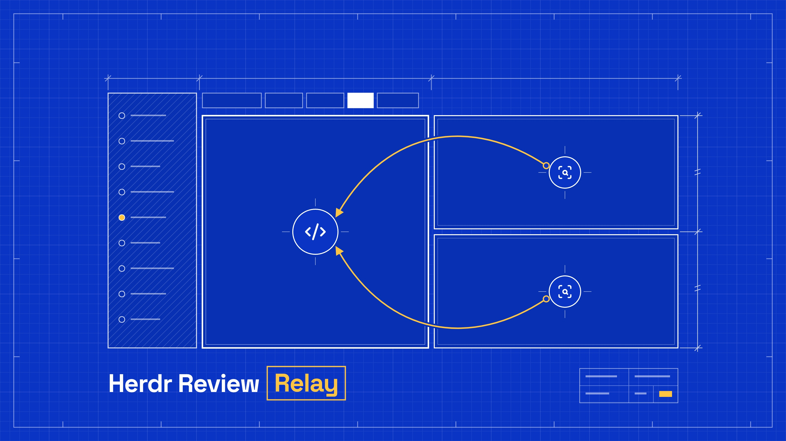

# Herdr Review Relay

[](https://github.com/Siregar/herdr-review-relay/actions/workflows/ci.yml)
[](https://github.com/Siregar/herdr-review-relay/actions/workflows/test.yml)
[](#setup)
[](https://herdr.dev/docs/marketplace/)
[](https://nodejs.org)
[](herdr-plugin.toml)
[](LICENSE)



A [herdr](https://herdr.dev) plugin for one Engineering agent and any number of QA agents in one tab. One key sends Engineering's PR to every QA agent, waits for all their reviews, and hands them to Engineering in one prompt. A follow-up such as `/goal` comes after that.

Reviews are read from each agent's own records (the Claude Code transcript, `opencode session export`), never from the screen. Nothing is cut short or wrapped, however long a path is.

The relay only types into sessions that are already running. Model, effort and agent stay whatever you set in each pane.

## Flow

1. Press `prefix+a` in the tab.
2. The PR is the one `gh pr view` finds for Engineering's checkout. If the branch has no PR, it is the last link Engineering wrote in its session to a PR in the checkout's repository; links to PRs in other repositories are passed over, and a session that links only those is refused. A failing gh (auth, network) is refused as such, not as a missing PR.
3. Each QA pane gets its review command (`reviewPrompt`). A QA pane that already reviewed in its current session gets `/clear` first.
4. The relay waits until every QA agent is done. When one stops at a question or an approval, you get a "needs you" notification, and the wait goes on once you have answered; the time it waits for you does not count against the timeout, so the relay keeps the tab until you answer. For Claude Code, done needs more than herdr reporting idle. Its transcript must also show no background task still running and a closed turn, because the agent goes idle while it waits for a background task such as a CI watch or a background sub-agent. A background shell that never reports (a dev server, a watch loop) is given up once the agent has sat idle on shells alone for `backgroundGraceMinutes`; the run log names them. Background sub-agents are waited for until the timeout, since they always report.
5. Engineering gets `handoffIntro`, followed by each review in a `<review from="QA #1" agent="Claude Code">` block.
6. Once Engineering is done, it gets `followUp`. When that has finished too, you get a "ready for you" notification.

Every handoff is also kept under `$HERDR_PLUGIN_STATE_DIR/runs/`. If one QA review fails, nothing is sent to Engineering, and the reviews that did finish are in that file.

`prefix+y` copies the focused agent's last reply to the clipboard, from the same records.

## When the relay refuses or fails

Every message names its cause in the title and one next step in the body, such as "No PR for feat/login: Have Engineering open the PR, then run the review relay again." Long paths, pane ids and gh's own output go under "Details", which only the popup shows. The plugin log (`herdr plugin log list --plugin review-relay`) has every message in full, details included.

- **Refusal**: the relay declines before it has typed into any pane (no PR, no QA panes, a busy pane, gh unreachable, an invalid `config.json`). The message comes seconds after you start the relay, so it opens a popup over the tab. Enter or Esc closes it. If herdr refuses the popup, for example because Settings is open, you get a notification instead.
- **Failure**: a review round stops after the relay has typed into a pane, such as a QA agent that timed out or ended without a review. You may have left by then, so it comes as a notification, saying what is safe and what running the relay again does. If herdr does not show the notification (`[ui.toast] delivery` is `off`, or `system` delivery found no foreground client), the popup opens instead.
- **"needs you"** follows the Failure route: notification first, the popup when it is not shown.
- **"review started", "ready" and "Copied"** are notifications only. One that herdr does not show is left in the log, never in a popup, since a popup takes the keyboard until you close it.

Starting the relay always ends in exactly one message: a Refusal or "review started". "review started" is a notification only, so with `system` delivery it can end up in the log alone. A crash says "Review relay crashed" through the same channels, with the stack trace in the plugin log. Runs from a terminal (`--dry-run`, `--stdout`) print their messages to the terminal only.

See [ADR 0001](docs/adr/0001-refusals-as-popup.md) for why a Refusal opens a popup rather than a notification.

## Setup

Requires Node 22.18 or later, `gh`, and herdr 0.9.0 or later. Claude Code and OpenCode are supported.

```sh
herdr integration install claude     # herdr learns each pane's session id
herdr integration install opencode   # restart running OpenCode panes afterwards
herdr plugin install Siregar/herdr-review-relay
```

The plugin has no build step and no runtime dependencies; Node runs the TypeScript sources directly. To work on a local checkout instead, use `herdr plugin link /path/to/herdr-review-relay`.

Label the panes: right-click a pane > Rename, or `herdr pane rename <pane> "QA #1"`.

- `Engineering`: optional. Without it, the pane you press the key in is Engineering.
- `QA #1`, `QA #2`, ...: one per QA agent.

Bind the actions in `~/.config/herdr/config.toml`:

```toml
[[keys.command]]
key = "prefix+a"
type = "plugin_action"
command = "review-relay.run"

[[keys.command]]
key = "prefix+y"
type = "plugin_action"
command = "review-relay.copy"
```

## Configuration

`config.json` in `herdr plugin config-dir review-relay`. Every key is optional; these are the defaults:

```json
{
  "engineeringLabel": "Engineering",
  "qaLabelPattern": "^QA #(\\d+)$",
  "reviewPrompt": {
    "claude": "/mattpocock-skills:code-review {pr}",
    "opencode": "/code-review {pr}"
  },
  "handoffIntro": "Here is the feedback from {count} independent QA agents on PR #{pr}. Check the feedback and fix issues.",
  "followUp": "/goal green ci, no merge conflicts and mergeable",
  "reviewTimeoutMinutes": 90,
  "engineeringTimeoutMinutes": 240,
  "backgroundGraceMinutes": 30
}
```

Set `followUp` to `null` to skip it. `qaLabelPattern` needs a capture group for the QA number.

## Development

```sh
pnpm install
pnpm test        # node --test, about 15 s: a few tests run whole review rounds on the real clock
pnpm typecheck
node src/relay.ts run --dry-run --pane <pane id>   # roles, PR and prompts, sends nothing
node src/relay.ts copy --pane <pane id> --stdout   # last reply to stdout
```

`herdr plugin log list --plugin review-relay` shows each run's output.

## License

[MIT](LICENSE)
